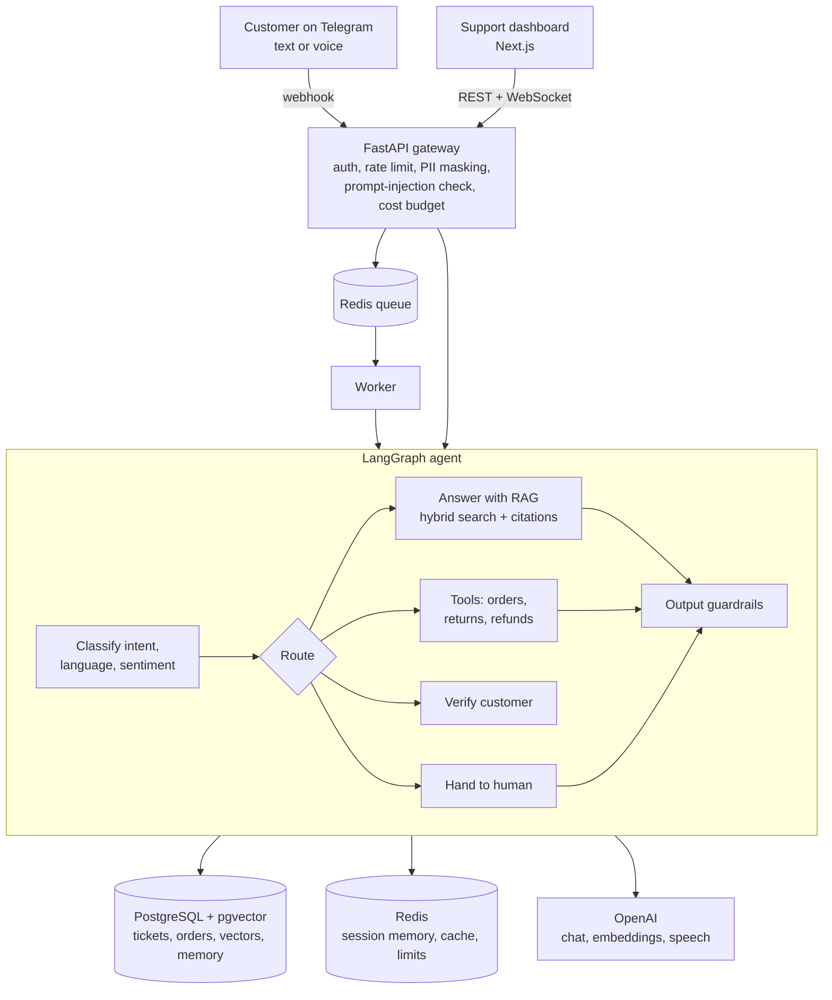

# ResolveAI

**A multi-channel, agentic AI customer support platform.** Customers of an online store (the demo client is "UrbanCart") message a Telegram bot in English, Hindi or Hinglish, by text or voice note. An AI agent answers from the store's help articles, looks up orders, schedules returns and raises refunds. When it is unsure, or an action needs approval, it hands the conversation to a human. The support team works in a web dashboard: a live inbox, refund approvals, analytics on cost and quality, a knowledge base and an evaluation suite.

It is built the way production GenAI systems are built: guardrails on input and output, cost tracking and budgets, conversation memory with summarisation, offline evaluations that gate CI, and infrastructure as code on AWS.



## What it does

| Area | Details |
|---|---|
| **Agent** | LangGraph state machine: classify, route, verify the customer, call tools, answer with RAG, escalate, check output. Explicit nodes make it predictable and testable. |
| **RAG** | Markdown help articles, chunked by heading, embedded into pgvector. Hybrid retrieval (vector + Postgres full-text) fused with Reciprocal Rank Fusion, optional LLM reranking, answers with numbered citations, low-similarity questions escalate instead of guessing. Re-indexing is idempotent (content hashes). |
| **Tools** | `list_orders`, `get_order`, `cancel_order`, `request_return`, `request_refund`. Every tool is scoped to the verified customer, so the model cannot touch another customer's data. Refunds always wait for human approval. |
| **Voice** | Telegram voice notes are transcribed (`gpt-4o-mini-transcribe`), answered by the same agent and replied to as a voice note (`gpt-4o-mini-tts`) with a text caption. Text in gets text out. |
| **Languages** | English, Hindi and Hinglish, detected per message; replies match the customer's language. |
| **Human in the loop** | Escalation on request, anger, low retrieval similarity, low answer confidence or failed grounding. Agents take over, reply from the dashboard (delivered on Telegram), approve refunds, hand back to the AI and resolve. Customers rate the help with 1 to 5 buttons (CSAT). |
| **Guardrails** | PII masking before anything is stored or sent to the model (email, Indian phone numbers, cards with Luhn check, Aadhaar, PAN, OTPs); prompt-injection detection in English and Hinglish; OpenAI moderation; output checks for citations, grounding, leaked PII and forbidden phrases; rate limiting; audit log of every action. |
| **Cost management** | Every model call is recorded with tokens, cost and latency. Model routing (a small model by default, a stronger one for upset customers, long questions and retries), an answer cache, prompt-cache keys, fixed templates where an LLM adds nothing, and daily budgets (global and per customer) that hand over to humans when exceeded. |
| **Memory** | Last N turns in Redis with a TTL; older turns summarised into long-term customer memory in Postgres; context trimmed to a token budget before each call. |
| **Evaluation** | 33 RAG questions, 20 intent examples and 25 safety cases. Metrics: retrieval hit rate and MRR, faithfulness and answer relevance (LLM-as-judge), keyword coverage, intent accuracy, injection recall and false-positive rate, PII accuracy. Thresholds fail the CI build. Runs from the dashboard too. |
| **Observability** | Structured JSON logs, per-message cost, latency and confidence, an analytics page (AI resolution rate, escalation rate, p50/p95 latency, cost per ticket, cache hit rate, CSAT, guardrail events, cost by model and step), CloudWatch logs and alarms on AWS. |
| **Infrastructure** | Docker Compose locally. Terraform on AWS: ECS Fargate (ARM64), RDS PostgreSQL 16 with pgvector, ElastiCache Redis, ALB behind CloudFront (free HTTPS for the Telegram webhook), Secrets Manager, ECR, CloudWatch, AWS Budgets. GitHub Actions for lint, tests, eval gate, dashboard build and an offline Terraform test. |

## Tech stack

Python 3.13, FastAPI, Pydantic v2, LangGraph, OpenAI SDK, SQLAlchemy 2 (async) + Alembic, PostgreSQL 16 + pgvector, Redis, structlog, pytest, Ruff, uv. Next.js 16 (static export), React 19, TypeScript, Tailwind CSS 4, Recharts. Docker, Terraform, AWS, GitHub Actions.

## Run it on your Mac

You need **Docker Desktop** running. That's all for the first run.

```bash
cp .env.example .env        # works as-is in offline mode (LLM_PROVIDER=fake)
make up                     # or: docker compose up --build -d
```

Open **http://localhost:8000** and sign in with `admin@resolveai.dev` / `ChangeMe123!` (change them in `.env`). Go to **Test console** and click the example messages in order.

To use real models, set `LLM_PROVIDER=openai` and `OPENAI_API_KEY=sk-...` in `.env`, then `make up` again. To connect Telegram, follow [docs/TELEGRAM_SETUP.md](docs/TELEGRAM_SETUP.md): locally the worker polls Telegram, so no public URL is needed.

The offline "fake" provider is a rule-based stand-in for the LLM. It exercises every code path (structured output, tool calls, embeddings, voice, costs), so the app, tests and CI run without a key, but its answers are plain. Use a real key to see the real assistant.

## Deploy to AWS

```bash
cp infra/terraform/terraform.tfvars.example infra/terraform/terraform.tfvars   # fill in keys
make aws-deploy      # builds, pushes, creates everything, sets the Telegram webhook
make aws-destroy     # deletes everything when you are done
```

Step-by-step guide, IAM setup, costs and troubleshooting: [docs/AWS_DEPLOYMENT.md](docs/AWS_DEPLOYMENT.md).

## Push to GitHub

```bash
git init && git add . && git commit -m "ResolveAI: agentic AI customer support platform"
git branch -M main
git remote add origin https://github.com/<your-username>/resolveai.git   # create the empty repo on GitHub first
git push -u origin main
```

`.env`, `terraform.tfvars` and Terraform state are git-ignored, so no keys are pushed. GitHub Actions runs lint, tests, the eval gate, the dashboard build and the Terraform test on every push.

## Tests and evaluations

```bash
make dev-deps        # one-time: installs Python (via uv) and Node packages
make test            # 34 tests; needs `make up` running for Postgres and Redis
make evals           # evaluation suite against the running app
make lint
```

Tests cover guardrails, chunking and retrieval, every conversation path (verification, tools, refunds, escalation, injection, PII, rate limit, budget, Hindi), the dashboard API, the Telegram adapter (text, voice, ratings, webhook security and idempotency), auto-resolve, and the real OpenAI client against a local mock of the OpenAI API.

## Project structure

```
backend/
  app/
    agent/        LangGraph graph, prompts, structured-output schemas, tools
    rag/          ingestion (chunking, embeddings) and hybrid retriever
    guardrails/   PII masking, prompt-injection detection, output checks
    llm/          provider interface, OpenAI and offline providers, gateway (cost tracking), prices
    services/     conversation pipeline, memory, costs, rate limit, live events
    channels/     Telegram adapter (webhook, polling, voice, ratings)
    api/          REST routes, auth, WebSocket
    evals.py      evaluation suite      worker.py   queue consumer and auto-resolve
  data/knowledge/ the client's help articles (Markdown)
  evals/          golden datasets
  migrations/     Alembic
  tests/
dashboard/        Next.js support console
infra/terraform/  AWS infrastructure     infra/scripts/  deploy, webhook, destroy
docs/             Telegram setup and AWS deployment guides
```

## Design decisions

- **Explicit graph over a free-running agent.** The LLM classifies and phrases; code decides what is allowed. Easier to test, cheaper, and no surprise tool calls.
- **Escalate rather than guess.** Low retrieval similarity, low confidence and failed grounding all hand off to a person.
- **One backend for every channel.** Telegram is a thin adapter; the web test console uses the same pipeline. Adding WhatsApp or web chat is a new adapter only.
- **Webhook into a queue.** The webhook answers Telegram in milliseconds and deduplicates retries; a worker does the slow LLM work.
- **Provider-neutral LLM layer.** All calls go through one gateway that records cost, so switching or mixing providers does not touch business logic.

## Known limitations and next steps

- Customer verification matches the registered email. Production should send a one-time code to that email first.
- Prices in `backend/app/llm/pricing.py` must be checked against current OpenAI pricing.
- Tracing is built in (database + logs). Exporting traces to Langfuse or OpenTelemetry is a natural next step.
- Live phone-style voice calls (OpenAI Realtime API) and more channels (WhatsApp, web widget) are not included.
